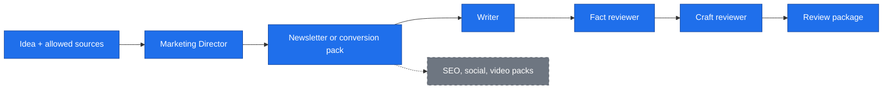
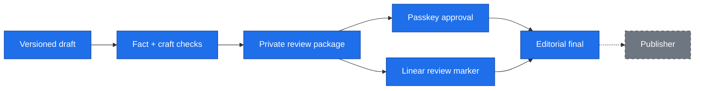
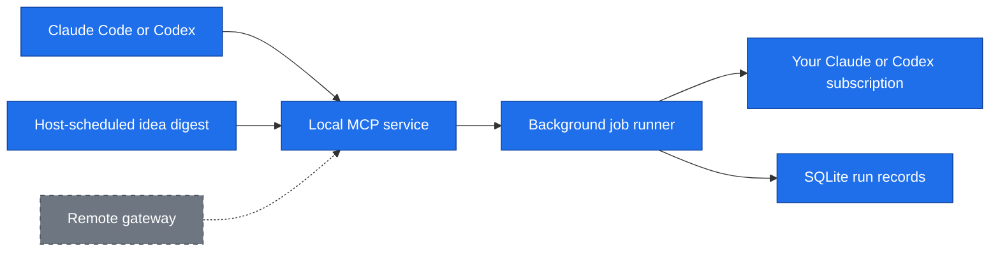
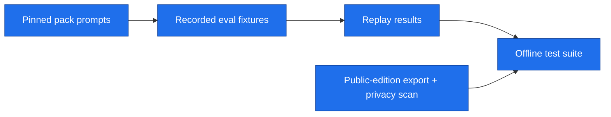

# Marketing Studio

Marketing Studio is a model-agnostic AI workflow for marketing: a shared studio where a Director routes source-backed ideas to versioned specialist packs, independent review, and owner approval. Newsletter and conversion-copywriting packs run today. SEO and social are future contracts; video is a placeholder, while publishing and scheduling are deferred. The system gives marketers—and anyone in a business who does marketing—a source-aware way to research and create content while keeping the owner in control of what goes out.

I built it so a rough idea and permitted business sources can become a private draft with its evidence, checks, and decisions attached. A separate private workspace holds each business’s sources, audience settings, decisions, and run history; the reusable framework holds the workflow, prompts, integrations, tests, and synthetic examples.

## What this demonstrates

| Concept | How it is implemented | Where to look |
| --- | --- | --- |
| AI agents / model-agnostic workflow | Defined Director, writer, fact reviewer, and craft reviewer roles turn an approved direction into a review package; providers sit behind one ModelPort interface. | `studio-runner/src/agent-run.ts`, `packs/newsletter/pack.json`, `studio-runner/src/model-port.ts` |
| Director/specialist orchestration | The runner coordinates separate role invocations, bounded revision, quality gates, and an owner handoff. | `studio-runner/src/agent-run.ts` |
| MCP/tool integrations | A loopback Service exposes named, schema-checked Studio tools to Claude Code or Codex through Model Context Protocol (MCP). | `studio-runner/src/service/studio-service.ts` |
| Retrieval over a source catalog | Keyword retrieval ranks catalog sections and returns short source passages instead of whole files. | `studio-runner/src/director-session.ts` |
| Guardrails and approval boundaries | Source-bound claims, scoped disclosures, independent fact and craft review, draft-only permissions, and owner/default API-key refusal constrain a run. | `studio-runner/src/agent-run.ts`, `studio-runner/src/model-port.ts` |
| Human-in-the-loop approval | The owner reviews an exact draft version; the local Inbox can bind that decision to a passkey assertion. | `studio-runner/src/agent-run.ts`, `studio-runner/src/service/studio-service.ts` |
| Prompt versioning and pinning | A run records the pack manifest and the prompts, skills, rubrics, and workspace context that shaped it. | `studio-runner/src/pack-loader.ts`, `studio-runner/src/agent-run.ts` |
| Privacy-aware source handling | Catalog redaction, restricted-source disclosure, and role-scoped excerpts are enforced before model calls. | `studio-runner/src/director-session.ts`, `studio-runner/src/agent-run.ts`, `studio-runner/src/source-disclosure.ts` |
| Recorded eval fixtures and regression checks | Synthetic fixtures replay deterministic agent responses, detect stale prompt hashes, and report regressions. | `studio-runner/src/eval.ts`, `packs/*/evals/` |
| Observability and run records | SQLite records run state, steps, artifacts, and recovery information; review packages preserve the draft and QA results. | `studio-runner/src/runner.ts`, `studio-runner/src/agent-run.ts` |
| Testing | Node and Python suites cover source boundaries, approval, recovery, pack behavior, and negative publish controls. | `studio-runner/test/`, `tests/` |

## How a newsletter gets made

Here is a representative example. I have a note that applicants abandon a job search when the next step is unclear, and I want a newsletter about that problem. I use the Marketing Director, a local agent role that helps decide what to make before it asks a writer to draft.

1. I start in Claude Code or Codex with the note and the question I want to explore. The Director uses retrieval over the source catalog and returns relevant passages; it flags gaps rather than inventing facts.
2. We agree on the reader, angle, evidence, and exclusions. In this example: explain one useful next step, do not promise hiring outcomes, and cite the product notes that support the description.
3. I ask for a newsletter. The Runner, the local program that carries out the workflow, sends the request to a versioned capability pack. A pack is the instructions and quality rules for one type of work; newsletter and conversion copy are the two packs that run today.
4. The pack orchestrates four roles: a Director for the brief, a writer for the draft, a fact reviewer for claims against permitted sources, and a craft reviewer for clarity and reader value. The reviewers are separate invocations, not a writer grading its own answer.
5. The Runner saves a review package: the draft version, its claim list, fact findings, craft findings, source versions, prompt pins, and open blockers. An unsupported claim or must-fix editorial finding remains visible in that package.
6. I revise, ask for another version, or approve one exact version. Each version has a digest—a short fingerprint of its exact contents—so a later edit cannot inherit an earlier approval.

Editorial approval accepts private marketing copy. It does not publish, schedule, change an account, or send anything. Those integrations are not present in this release.

## Architecture

Blue boxes are implemented or fixture-tested. Gray dashed boxes are planned.

### Creative layer

The creative layer turns an agreed direction into a draft that can be checked. Separating the writer from the reviewers makes each claim and writing problem inspectable instead of treating one model response as the final answer.



- The Director can stop before drafting when the available sources cannot support the idea.
- The newsletter pack requires source-linked claims and a minimum draft length. The conversion pack uses the same shared pipeline with its own writing rubric.
- A fact finding is evidence for the owner to review, not a guarantee that a draft is true.

### Business context layer

The framework does not contain a company’s customer notes, product facts, or draft history. A private workspace outside the repository names the folders and sources the Studio may use.


- Context search is section-level keyword retrieval over approved catalog and context files. It returns ranked snippets, not whole documents.
- The catalog can mark a source as restricted. The Runner requires a narrow disclosure before a role can see restricted text.
- Onboarding records owner-provided workspace guidance and source references locally; it does not import or authenticate sources. Website, docs, Notion and Drive imports remain planned.

### Review and approval layer

Every draft stays private until the owner inspects it. The approval flow binds a decision to the exact draft, current quality checks, and, for a series, the current Linear revision.



- The local Studio Inbox uses a passkey by default and records approval for the exact version shown to the owner.
- A business can instead use a named Linear review marker. That route is recorded as unauthenticated, so it cannot satisfy a future publishing requirement.
- Studio does not hold a Linear token. A host connector performs the Linear read or write and returns a receipt.
- An editorial final remains private; publishing is planned separately.

### Runtime and integration layer

Marketing Studio runs locally from Claude Code or Codex. A local Service gives the host a small set of Studio tools through MCP, a standard way for an AI host to call named tools.



- The Service listens only on the laptop’s loopback address, so another machine cannot reach it over the network.
- It defaults to a fixture: deterministic canned output for tests and dry runs. A business can configure its logged-in Claude Code or Codex subscription for drafting.
- The Runner keeps run state in SQLite, a file-based database, so a stopped local job can be inspected or resumed.
- Owner runs refuse API-key environments and use the subscription already signed into Claude Code or Codex.
- A scheduled host task can collect a bounded idea digest and send an idea to the owner’s inbox. Studio itself has no scheduler, does not make a model call for that scan, and cannot create a draft from it.

### Quality and maintenance layer

The framework checks that its workflow keeps behaving as expected when prompts or code change. This is regression evidence about the mechanics, not a claim that every model draft is good.



- Packs pin the prompts, skills, and review rubric used for a run. A later edit cannot silently change an existing record.
- Recorded eval fixtures replay synthetic source cases, including unsupported claims and privacy boundaries. A prompt-hash mismatch makes a recording stale instead of replaying it as current.
- The test suites exercise source disclosure, approval, recovery, Service/MCP behavior, negative publishing controls, pack mechanics, and the Python metadata gate. The committed public-edition exporter adds a clean-source check, an allowlist manifest, an atomic staging gate, and a privacy scan before exposing an output.

### Current status

- Laptop-local and loopback-only; the Service uses fixtures by default.
- Newsletter and conversion-copywriting packs are implemented. SEO and social are future contracts; video is a placeholder, while publishing and scheduling are deferred.
- Real subscription-backed Service and host cold-start acceptance remain to be completed; use synthetic or nonsensitive material for current local work.
- Remote access, sensitive or multi-user use, publishing, scheduling, account changes, and analytics are deferred. No publisher, scheduler, or account connector exists.

### What users get next

- A guided, owner-reviewed path from research to a new marketing specialist in the Studio.
- More specialist packs, beginning with an owner-chosen format; SEO and social are future contracts, while video is paused.
- A better idea-review experience: a host can gather a bounded digest, while the owner chooses which ideas deserve a direction or draft.
- Future retrieval work may add vector and graph-based retrieval; the current implementation is keyword retrieval over a source catalog.
- Validated subscription-backed runs in Claude Code and Codex using synthetic data before they are recommended for broader use.
- Designed remote collaboration, source imports, publishing, scheduling, and analytics only after their user controls and approval requirements are defined.

## Run it with your own business

Use GitHub's **Code** button to clone this repository, or unpack a source archive into a directory available on your machine. You need Git, Node 26 (Node 22.16 also works), Python 3, and Claude Code or Codex logged in with a subscription. Do not add an API key: the Studio refuses API-key environments for the owner workflow.

```sh
# In GitHub, copy the repository URL from Code, or unpack an archive instead.
git clone <repository-url-from-GitHub> ~/marketing-studio
cd ~/marketing-studio
export STUDIO_CORE="$PWD"
"$STUDIO_CORE/studio-runner/bin/studio" doctor
```

Create a private workspace outside the clone. The included `studio-self` template is a safe first run because it uses this repository’s public docs rather than customer material.

```sh
export STUDIO_WORKSPACE="$HOME/studio-workspaces/studio-self"
mkdir -p "$STUDIO_WORKSPACE"
cp "$STUDIO_CORE/templates/workspace/studio-self/studio-workspace.json" "$STUDIO_WORKSPACE/"
sed "s#/ABSOLUTE/PATH/TO/[^\"]*#$STUDIO_CORE#" \
  "$STUDIO_CORE/templates/workspace/studio-self/studio-business.json" \
  > "$STUDIO_WORKSPACE/studio-business.json"
"$STUDIO_CORE/studio-runner/bin/studio" context-search \
  --workspace "$STUDIO_WORKSPACE" --query roadmap
```

For a dry run, follow [Getting Started](docs/GETTING-STARTED.md) to start the local Service with its fixture provider. For a real draft, choose `claude-code-cli` or `codex-cli` in the business configuration and use only nonsensitive material until the documented local installation has been verified. The full setup also explains the local passkey Inbox and optional Linear review.

## How this reusable core relates to private work

Marketing Studio separates the reusable Core from a private business workspace. This draft focuses on the reusable system and its synthetic fixtures; business-specific material stays outside the repository.

- The reusable part is the Runner, packs, host installers, tests, templates, and architecture documents.
- The private part is company sources, customer context, chat exports, drafts, local tokens, and run state.
- Publication to a repository is a separate owner-controlled action. The committed exporter creates a reviewed allowlisted copy from a clean committed source, records `EXPORT-MANIFEST.json`, scans the staged tree, and exposes no output until the gates pass. It performs no publication.
- Fixtures are canned test data. They demonstrate the workflow, not a live marketing result.

## Ownership

I designed the system, architecture, integrations, and operating boundaries, then directed the implementation. I made the decisions about what the Studio may read, how its agents coordinate, how drafts are checked, and how owner approval stays separate from external action.

## Read more

- [Getting Started](docs/GETTING-STARTED.md) for a local dry run and installation steps.
- [Architecture](docs/ARCHITECTURE.md) for the current implementation boundary.
- [Roadmap](docs/ROADMAP.md) for implemented, fixture-tested, deferred, and not-yet-done work.
- [Authority and capability status](docs/operations/AUTHORITY-AND-CAPABILITY-STATUS.md) for approval and security limits.
