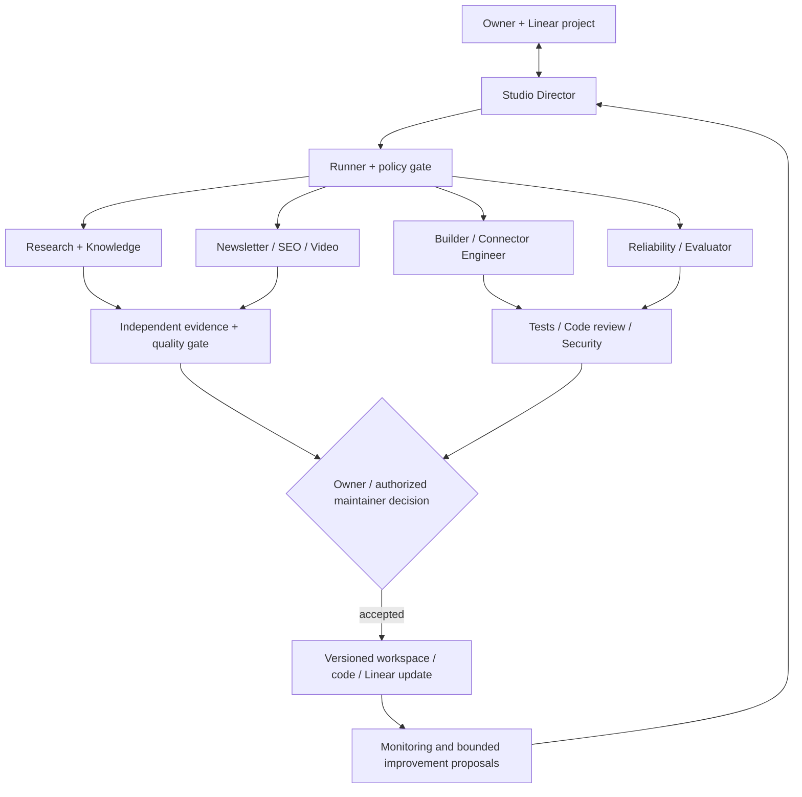

# Studio agent teams, delegated execution and maintenance

**Status:** Proposed role architecture for a future model-agnostic Studio runner. **No autonomous subagent spawner has been implemented or deployed.**

## Work organization

The **Director** collaborates with the owner, selects useful work and delegates bounded outcomes. The **Runner** spawns permitted workers and controls provider access, cost, state, retries and stop rules. Each **worker** produces evidence-backed results with a declared scope. A **Reviewer** runs a separate check before important artifacts progress.



## Worker families

| Family | Specialist | Owns | Must not do without approval |
|---|---|---|---|
| Strategy | Director | Prioritization, research strategy, questions, campaign planning, choice of worker | Treat brainstorm as publication instruction, bypass user intent |
| Creative | Newsletter Editorial | Long-form research, issue structure, copy, sources and educational examples | Publish, fabricate voice or source, claim launch |
| Creative | SEO / Growth | Search intent, competitive research, original information gain, blog structure, content distribution hypothesis | Reuse newsletters verbatim for different intent by default |
| Creative | Video / Design | Script, storyboards, motion direction, brand and production pipeline | Replace proven video tooling or publish videos without tests |
| Research | Audience Scout / Source Archivist | Collect real user questions and original company sources with provenance, identify contradictions | Invent customer replies, ingest unapproved chats |
| Evaluation | Fact and Privacy Reviewer | Verify primary evidence, source freshness, legal/privacy boundaries and attribution | Overrule owner consent or assume a passing score |
| Evaluation | Editorial Reviewer / Unslop | Detect generic shape, weak structure, unnatural voice and unsupported rhetorical claims | Turn heuristics into global bans, invent missing personal details |
| Engineering | Runtime Builder | CLI/daemon, adapters, state store, budget and permission enforcement | Merge protected code, secretly deploy or connect accounts |
| Engineering | Skill Maintainer | Propose scoped skill diffs, update fixtures, run regression tests, version packages | Change foundational design based on one piece of feedback |
| Engineering | Reliability Watchdog | Observe stale tasks, runaway loops, broken links, drift, cost/latency, suggest recovery | Self-enable schedules or alter company strategy |
| Operations | Distribution Adapter | Prepare and execute exact approved content to authorized channel, idempotent receipt | Guess destination, publish from draft approval alone |

## Spawn/delegation contract

Every worker invocation must include:

```yaml
worker_id: newsletter_editorial
parent_run_id: "<durable run>"
objective: "Explain one real decision for first-time product builders"
deliverable:
  schema: "markdown_draft + source_ledger + qa_findings"
  destination: "<authorized workspace/branch>"
inputs:
  links: ["<provenance-aware source list with access rights>"]
  approvals: ["<scope and privacy>"]
quality_bar: ["source accuracy", "reader value", "no invented author persona"]
model:
  required_tier: T2
  escalation_max: T3
  provider_preference: "auto by capability registry"
budget:
  max_model_calls: "<owner policy>"
  max_steps: 10
  timeout_seconds: 900
permissions:
  read: ["<explicit allowlist>"]
  write: ["<draft path>"]
  deny: ["publish", "merge", "credentials"]
failure_mode: "return partial work + blockers + next action"
```

This is an example schema, not a claim that those model tiers or credentials are currently configured.

## Workflow versus genuinely agentic decision-making

A workflow says *how to perform* a repeatable job. A specialist agent may choose between useful workflows, ask a consequential question, reject an unsupported angle, or request different research. The Director chooses which specialists work and how their results fit the marketing strategy. The runner makes tool actions durable and observable. The **system is agentic when these roles and decisions execute in actual software with persisted state and authorized tools**; Markdown role descriptions alone do not provide that execution.

## Self-improvement responsibility boundary

The Reliability Watchdog and Skill Maintainer may **propose** changes, run isolated benchmark tests and open draft PRs. A shared core or authority model change needs human architecture review. Accepting a single piece of editorial feedback normally changes **one asset**. Repeated supported improvements can become a specialist rule after cross-topic evaluation. Follow [QUALITY-EVOLUTION.md](../docs/operations/QUALITY-EVOLUTION.md).

## Models and budgets

Model selection follows [MODEL-AND-SUBAGENT-ROUTING.md](MODEL-AND-SUBAGENT-ROUTING.md). Use deterministic and cheap models for source sorting, balanced for routine drafting, expensive reasoning for genuinely complex strategy/contradiction or critical engineering. Record cost, latency, provider, model version, actual context, retries and reviewer outcomes. The user can override for evaluation; respect configured budgets and privacy restrictions.
