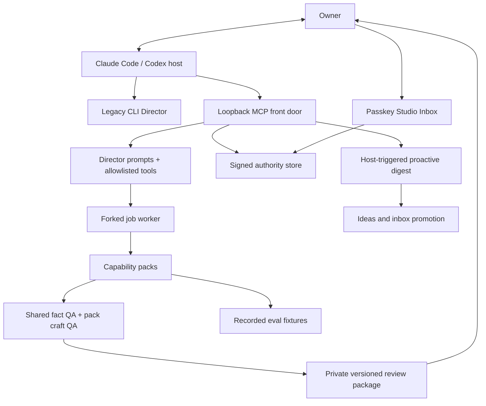

# Architecture: Marketing Studio Core

This is the current architecture of `main` (see `git log`). The owner runs it on a laptop with subscription-only bring-your-own AI. The Service is local and fixture-backed by default; tenant configuration can select a local Claude Code or Codex subscription provider. Remote access, customer-key API billing and publishing are deferred ([owner policy](operations/AUTHORITY-AND-CAPABILITY-STATUS.md#owner-policy-2026-11-14)).

## Current system



The legacy CLI and the generated MCP Director coexist until the Service reaches parity. The CLI owns the broader session/evidence/revise/cancel workflow and can use the local subscription adapters. The Service owns its own signed authority, inbox and async tenant-configured route (fixture by default); its workers never receive authority-write tools.

## Implemented execution paths

### Legacy CLI Director

`hosts/claude-code/marketing-director-cli/SKILL.md` drives `studio-runner/bin/studio`. It supports sessions, context search, evidence, scoped disclosure, direction approval, the generic `text-asset` pipeline, revisions, exact-version editorial review and handoff. The local subscription adapters refuse their API-key environments; `claude-code-cli` uses the owner's Claude app login and `codex-cli` is also available where the tenant selects it. Codex remains a conversation host separately from that provider.

CLI owner quotes, grants and approvals are local assertions. Host permission prompts are convenience controls. A shell-capable same-user process can bypass them and can reproduce the legacy VULN-1 and VULN-7b cases. This path remains useful for trusted synthetic or nonsensitive local work and is not the authority boundary for sensitive data.

### Studio Service and MCP

`studio-runner/bin/studio-service` listens on `127.0.0.1` and exposes a bearer-token MCP endpoint plus a separate `http://localhost:<port>/inbox` owner surface. The Service currently provides Director prompts, MCP tools for sessions, programs, pieces and host-side Linear sync, signed per-tenant authority records, passkey assertions, pending requests, exact-version approval checks, and forked job workers. The worker uses the provider persisted in the tenant record; new tenants default to the fixture provider.

MCP can request direction or disclosure approval, start an already approved tenant-configured run, inspect status, and submit bounded proactive ideas. It cannot write authority, approve, publish, spend, alter accounts or start a proactive draft. The inbox is the only Service authority writer. `ASSET_APPROVED` means exact-version private editorial approval; nothing publishes.

### Series, Linear and review policy

A series or campaign is a Service-owned `program` of ordered `piece` records. Linear is the collaboration surface, reached only through the owner's host connector: the Service emits idempotent change sets and records host receipts, and never holds a Linear token. A tenant `review_policy` (fixed at first start, default `passkey`) decides who can finalize a plan or piece:

- `passkey`: the owner inbox shows the draft bytes, QA digest and Linear document revision; the passkey challenge binds that digest, so a changed document, revision or QA invalidates it. The signed `piece_final` record is written only by the owner channel.
- `linear-review`: the host reports the agreed marker comment (`/studio approve-plan <program>`, `/studio final <piece>`) read through its connector. The Service accepts it only from the tenant's named Linear account, on the current document revision, after its latest edit, and records `authenticated: false`. The marker tool is not offered to passkey tenants.

The Service cannot see live Linear. A final is checked against the last document the host ingested or read, so it can lag an un-ingested Linear edit until the host ingests it, which reopens the piece. `linear-review` also rests on the host's honesty: the marker is host-asserted JSON: the Service cannot verify that the comment exists in Linear, so a host or model that invents one finalizes the piece. It is recorded `authenticated: false` and is never publish-eligible. A connector-signed Linear receipt is the planned hardening (see the roadmap).

Both policies re-read the Runner's fact and craft QA artifacts at final time: every claim must be verified, no unlisted claims, no must-fix findings, and the QA digest must match the recorded revision. Finality is derived from the signed record against the current revision, so a later edit, comment or new revision silently reopens the piece. `ProgramStore.publishGate` is the contract a future publisher must pass: a current passkey final plus a separate owner destination authorization. A `linear-review` final, a draft approval, a stale digest or Linear revision, or another destination is refused. No publish, schedule or account code exists.

The separate `studio-mcp` stdio server remains a limited local-tools interface. It is not the Service, has no network listener or authentication, and is never tunneled.

### Packs, QA and evals

The generic `text-asset` pipeline loads `packs/<id>/pack.json`, role prompts, role-scoped skills, deterministic gates and craft rules. `newsletter` and `conversion-copywriting` are current packs. Shared fact review remains loader-owned. The pack manifest and every prompt/skill/rubric used by a run are pinned for resume and revision.

Recorded synthetic evals exist for both packs. They test failure classes and clean fixture behavior; they do not prove semantic marketing quality or replace owner review. `SEO`, social, video and a specialist intake workflow remain future work.

### Proactive v0

Proactive behavior is implemented as a bounded, host-triggered loop. A scheduled task in the owner's Claude/Codex app calls the Service's `proactive_context` and `idea_submit` tools. The Service reads a bounded digest from watched local Git repositories and recent run outcomes, verifies source references, advances a cursor, and stores ideas. Owner promotion occurs in the passkey inbox and creates a pending direction request. The Service has no scheduler, model call or publisher.

PR #36 makes ordinary Git worktrees valid watched repositories while retaining path, symlink, external-gitdir and data-root checks. A future proactive v1 may add a stronger owner-reviewed intake flow, but pre-drafts and autonomous publishing are deferred.

## Trust boundary

| Surface | Can do | Cannot establish |
| --- | --- | --- |
| Host chat and generated shim | Call the configured MCP tools and prompts | Owner identity, approval, publication authority |
| MCP bearer | Create pending requests, run approved tenant-configured work, read bounded status, submit ideas | Authority writes, passkey actions, publishing or billing |
| Service worker | Execute the bound tenant-configured job with signed authority reads | Owner decisions or arbitrary tool access |
| Passkey inbox | Show signed snapshots and record direction, disclosure, plan, revision, exact-version and piece-final decisions | Remote/multi-user identity or protection from the same OS user replacing Service state |
| Linear marker (`linear-review` tenants only) | Record an unauthenticated plan approval or piece final from a named Linear account | Owner identity, passkey-grade finality or any publish authority |
| Legacy CLI | Run the full local workflow and live Claude subscription route | Authenticated owner identity or protection from a shell-capable agent |

The Service protects its own route from workspace-forgery attacks by keeping authority outside the copied workspace and requiring passkey assertions. It binds the inbox decision to the shown request or exact draft digest. It is still a laptop-local process under the same OS user. A same-user process that can replace the Service key/store before restart or replay an earlier store can forge or roll back authority. The [separate-user launchd install](operations/SEPARATE-USER-INSTALL.md) (the tracked authority milestone) closes this against non-admin same-user code; its script and tests exist, the live install is NOT RUN, and an admin/root user can still replace the store.

## Data hierarchy

```text
marketing-studio-core/                 reusable code, contracts, packs, skills, tests and synthetic fixtures
  studio-runner/                       CLI, Service, MCP interfaces, state and tests
  hosts/                               CLI and generated Service shims
  packs/                               newsletter, conversion and shared QA
  evaluations/                         eval definitions and ignored results

private business workspace/            never part of Core
  studio-business.json                 catalog, roots and local defaults
  studio-workspace.json                workspace identity
  context/ sources/ sessions/ captures/ business material and decisions
  .studio/                             legacy CLI state, artifacts, receipts and grants

private Service data root/             outside the copied workspace
  tenants/<tenant>/                    authority SQLite, key, jobs, pending requests and tenant record
```

The repository contains no tenant transcripts, customer facts or drafts. External webpages and transcripts are untrusted source data until an authorized host records them with provenance.

## Current limits and deferred work

- Laptop only; loopback-only today. Remote access is planned only through the approved remote-gateway design; never tunnel the stdio MCP. Owner/default runs are subscription-only and refuse API keys; a customer-key API adapter is deferred, not rejected. See the [owner policy](operations/AUTHORITY-AND-CAPABILITY-STATUS.md#owner-policy-2026-11-14).
- The Service defaults to fixtures; a tenant can select `claude-code-cli` or `codex-cli` for subscription-backed execution. A real-provider Service run and real host cold-start acceptance are not done.
- ChatGPT/Claude Chat, the remote gateway (OAuth, tenant mapping), sensitive or multi-user use, publishing, scheduling and analytics are deferred, not rejected.
- The legacy CLI and Service do not have parity. Keep both Director skills until sessions, evidence, captures, revise, cancel and real-provider execution work through the Service.

See [Getting Started](GETTING-STARTED.md), [Roadmap](ROADMAP.md), [authority status](operations/AUTHORITY-AND-CAPABILITY-STATUS.md), [host interface](hosts/HOST-INTERFACE.md), [scoped disclosure](security/SCOPED-DISCLOSURE.md), and [host-triggered proactive scan](hosts/PROACTIVE.md).
