# ADR-RUN-001 — First executable Marketing Studio Runner

**Historical design note:** This ADR predates the current implementation. The TypeScript/SQLite Runner, model-backed CLI route, loopback Service, signed authority store, passkey inbox and pack/eval system are now on `main`; see [current architecture](../ARCHITECTURE.md) and [roadmap](../ROADMAP.md). API adapters, hosting, separate-user installation and publishing remain open.

**Status:** Historical proposal; implementation decisions are recorded in ADR-002/003 and the current architecture.
**Date:** 2026-11-10 PT  
**Scope:** First *manual-triggered, draft-only, resumable* Director → Newsletter → independent QA → Owner review run in reusable `marketing-studio-core`.  
**Depends on:** [archived architecture baseline v1.0 draft](../archive/ARCHITECTURE-BASELINE-v1.0-DRAFT.md), [archived consolidated decisions](../archive/DECISION-CONSOLIDATION-v1.0-DRAFT.md), [Director](../../core/DIRECTOR.md), [specialist contract](../../core/SPECIALIST-CONTRACT.md), [Linear handoffs](../operations/LINEAR-AND-HANDOFFS.md), [quality-evolution safeguards](../operations/QUALITY-EVOLUTION.md).

> Design goals confirmed by the owner: a permanent reusable marketing-department framework; chat-first idea and source intake; Director handles creative planning; one-off assets can stay outside Linear; coordinated campaigns use Linear projects; source-backed specialists and QA; model-agnostic handoffs; cost-aware delegation; source/feedback-driven improvement with protected foundations. **The implementation stack, vendor credentials and hosting are still proposals.**

## Decision request in one paragraph

**Provisional recommendation:** Build a **TypeScript CLI on an actively supported Node.js LTS release (26.x as of November 2026)**, with **versioned JSON schemas (Zod), a thin explicit state-machine runner, a transactionally persisted SQLite run/event store for single-user local execution, and a model-provider interface** with one mock and at least one authorized real-model adapter. Use an external LLM SDK (e.g., Vercel AI SDK) *behind our interface*, not as the Studio's source of truth. Reuse the existing Python newsletter metadata gate by invoking its CLI as a bounded process with captured results; do not translate its logic silently. Implement only the newsletter and independent review worker adapters for the first vertical slice. Consider LangGraph/Mastra if the measured complexity of long-lived branching and human interrupts exceeds the simple runner; evaluate Temporal when there are genuinely multiple workers/hosts and sustained background workflows.

This recommendation needs **a short technical spike** confirming database driver, SDK/provider feature coverage, dependency security and a crash/restart scenario before implementation begins. There is no assumption that a ChatGPT/Claude subscription provides usable API credentials.

## Why this architecture now

At the time of this proposal the core repository contained Markdown contracts and a small synthetic suite. Current `main` contains a runnable CLI/pack pipeline and local Studio Service, but still has no publisher, API model adapter, generic subagent router or hosted boundary. The existing an example tenant business repo remains a separate external capability.

A first implementation that simply prompts the model to “do all the steps” cannot prove resumability, permissions, cost bounds, source provenance or independent review. A generalized distributed scheduler before a single correct run would add work without solving the initial content-quality issue. The chosen slice isolates those risks.

## Comparison — runtime language and main AI layer

| Candidate | Strengths for this Studio | Costs / failure modes | Recommendation |
|---|---|---|---|
| **A. TypeScript / Node LTS + explicit runner + model adapter** | Shared ecosystem with existing business video code; typed schemas; mature CLI/web/connector tools; provider-agnostic SDK option; future SaaS integration; one language for adapters and UI-facing APIs | Need to invoke the current Python gate or deliberately port with parity tests; we must implement tested transaction/lease/resume logic; rapid SDK changes require pinned dependencies | **Preferred for thin first slice**, pending spike |
| **B. Python + Pydantic AI + SQLite + typed steps** | Current newsletter validator/tests already Python; strong document/research ecosystem; typed model contracts; Pydantic AI supports multiple providers and optional durable backends | Later TS/Remotion/SaaS bridge; own process/worker state still needed; framework upgrade and provider variation require tests | **Credible fallback**, not a lower-quality choice |
| **C. TypeScript + LangGraph.js checkpointer** | Documented graph persistence, human interrupts, checkpoints and recovery; supports complex branching agent flows | Framework lifecycle/graph semantics; separate approval, tenant security, external idempotency and business-state ledger remain ours | **Spike if explicit runner becomes too complex** |
| **D. TypeScript + Mastra** | Agent/workflow tooling, suspension, model support and memory in a unified framework | More framework coupling and migration surface; still requires source authority, approvals, privacy and custom evaluation contracts | **Evaluate as a rival in spike, not assumed default** |
| **E. Temporal orchestrator from day one** | Designed for durable distributed workflows, replay and long waits; mature operational semantics for future proactive agents | Server/workers, deployment, determinism constraints, event-history management and operational cost at a stage with no background use case | **Defer to multi-worker/background milestone** |

**What we are deciding:** the *external Studio contracts* and a small implementation that can be replaced. We are **not** making Node, SQLite or a third-party SDK an immutable product principle. A provider-neutral `ModelPort`, `RunStore`, `SourcePort`, `WorkerPort` and `ArtifactPort` is the stability boundary.

## Source verification for technical claims

- [Node release schedule](https://github.com/nodejs/Release): 26.x moved into active LTS on 2026-10-28; pin the exact supported version in CI and runtime. LTS status is **not** proof of compatibility with each library.
- [Vercel AI SDK](https://vercel.com/ai-sdk): model/provider abstraction, text/structured output and tool calling; SDK is an implementation dependency, not an approval system.
- [LangGraph.js persistence](https://github.com/langchain-ai/langgraphjs/blob/main/docs/docs/concepts/persistence.md) and [interrupts](https://github.com/langchain-ai/langgraphjs/blob/main/docs/docs/concepts/human_in_the_loop.md): checkpoints and human-in-loop; these do **not** automatically make external GitHub/Linear writes idempotent.
- [Mastra repository](https://github.com/mastra-ai/mastra) and [HITL docs](https://mastra.ai/docs/agents/human-in-the-loop): workflow and suspension options.
- [Pydantic AI durable execution](https://pydantic.dev/docs/ai/capabilities/durable_execution/overview/): supports durable backends; distinguishes durable workflow from persisted snapshots.
- [Temporal workflow replay](https://docs.temporal.io/workflows): history/replay and deterministic workflow code, useful at distributed scale.
- [SQLite WAL documentation](https://www.sqlite.org/wal.html): local single-host behavior, constraints and a 2026 bug fix; any use of WAL with concurrent connections must pin a patched SQLite version and pass a corruption/recovery test.

Source pages were checked for architecture feasibility on 2026-11-10; SDK APIs, model availability and pricing must be verified again **at implementation time**.

## First execution topology

```mermaid
flowchart LR
  IN["Chat/CLI input, or Linear project URL"] --> CLI["studio run / studio resume"]
  CLI --> GOV["Policy, tenant manifest, source allowlists"]
  GOV --> STORE[("Local transactional run state + event log")]
  GOV --> DIR["Director worker (creative choices)"]
  DIR --> SRC["Source resolver / evidence pack"]
  SRC --> EDIT["Newsletter worker (skill-bound)"]
  EDIT --> MECH["Existing Python metadata validator"]
  MECH --> FACT["Independent claim/source reviewer"]
  FACT --> STYLE["Independent craft/unslop reviewer"]
  STYLE --> PKG["Director package assembler"]
  PKG --> WAIT["WAITING_FOR_OWNER (exact version)"]
  WAIT --> STORE
```

The CLI may be invoked by a local tool-capable environment (such as Claude Code/Codex). **An ordinary ChatGPT chat cannot be assumed to execute this local CLI**; before a hosted API/connector is implemented, ChatGPT can use the same source-linked handoff/Linear project manually through authorized tools. Host portability is contractual now and becomes actual cross-host execution only after an adapter/integration test.

### Run outline (bounded agency)

1. **Intake/policy:** typed request with `workspace_id`, one-off vs campaign, objective, links, allowed readers/writers, budget and optional Linear project. Infer no credentials or permission from a URL.
2. **Source resolution:** retrieve allowed original material; tag fetched pages, videos, chat exports and private files by origin, authority, version, fetch time, copyright/shareability, sensitivity and content hash. Reject inaccessible sources as unresolved; untrusted source text never becomes tool instructions.
3. **Director strategy:** agentic choice of reader, angle, form, evidence sufficiency and research needs; can ask a consequential clarification or return `INSUFFICIENT_EVIDENCE`. This is **not** a fixed sentence template.
4. **Delegation:** runner invokes only registered workers under a typed task envelope. The Director selects a task/capability class, while runner enforces provider availability, permissions, rate limits and budget.
5. **Newsletter editorial:** read *version-pinned* selected copywriting research, newsletter craft, educational-series and /unslop references as applicable; produce brief, source map, draft and JSON claim manifest.
6. **QA:** run the real `tools.newsletter_gate` (metadata only); independently check key claims against original source evidence; run separate craft check; revision budget max configured. Avoid claiming /unslop was run if only an adapter/heuristic was applied.
7. **Package:** Director creates a private versioned package (draft, optional requested asset briefs, subject lines, source/QA receipts, unresolved facts, owner questions) and writes `WAITING_FOR_OWNER`. Publishing remains unavailable.
8. **Resume:** a new authorized process/model reloads exact input/source/skill versions, run events and pending owner comments; recomputes only invalidated steps and records changes. No duplicate artifact or Linear tasks.

## State, persistence and idempotency design

**Local MVP:** SQLite single-host file under a gitignored per-workspace runtime directory. One active worker process per workspace, bounded concurrency=1 initially. Use ACID transactions for run-step state and outbox entries. Prefer the simplest journal mode safe for the selected driver; WAL only after version/health verification. Never store API keys or raw secret tokens in run events.

**Minimum records:** `runs` (run_id, workspace, objective, status, version pointers, deadline/budget); `steps` (step_id, role, attempt, claim/lease, transitions, input/output hashes); `events` (append-only state changes, timestamps and actor); `source_refs` (URI/version/hash/access classification); `artifacts` (content hash, URI, approval status); `approvals` (actor, action, exact digest, scope); `outbox` (external write and dedupe key); `usage` (model/provider, tokens, estimated and actual costs, latency).

**Remote writes:** GitHub/Linear and provider model calls are external, non-atomic APIs. Mark intent in outbox first, then perform write under an idempotency key `workspace:run:step:contentDigest:destination`. On crash, reconcile the remote destination against hash/commit/issue ID before retry. If unsure, stop for review rather than making a duplicate. No claim of exactly-once provider behavior. **LLM cost caveat:** a provider response may be billed but lost if the process dies before recording it. The runner cannot guarantee no duplicate billed call in that window unless a provider explicitly supports reliable request deduplication; otherwise it must log the possibility, set conservative budget ceilings, and mark uncertain usage for reconciliation. Exactly-once external side effects are never assumed.

**Artifact pinning:** save content to authorized private workspace path/branch with a SHA-256 digest, source commit IDs and skill revisions. Exact approved version never changes on a retry; a revision creates a new artifact version.

**Migration path:** if background runs or several concurrent hosts become necessary, adopt Postgres/event store or a durable workflow engine behind `RunStore`. SQLite local files aren't a cross-machine shared store. Do not use a network filesystem as if local WAL were safe.

## Permissions and security

- Default profile **draft-only**; explicit allowlists for source hosts/repos, branch/path writes, model providers and max spend. Scope external credentials to least privilege; keys from runtime secret store/environment, never committed to GitHub or passed into prompts.
- No capability for publish/send, account connection, deploy, merge, delete source, change core policy, destructive file edits, public release or payment in the first Runner.
- Separate **read**, **draft-write**, **owner content approval**, and **publish authorization** as distinct principals/actions; model text or a JSON `approved: true` field does not grant permission.
- External URLs, transcripts, uploaded docs and tool results are untrusted content. Strip/exclude instructions embedded in them from agent control context; permit only whitelisted tool schemas and audited actions. Preserve citations/rights, check access and public-use clearance.
- One workspace per tenant with separate runtime store, credential namespace and source manifest. Tests must prove private source from one workspace never enters another tenant's output.
- No generic arbitrary shell execution, arbitrary HTTP calls or remote code loading from worker prompts. Run the known Python gate as a command with a fixed argv allowlist and process timeout; all tool calls audited.
- Store only necessary source excerpts in model requests and redact known private details. Maintain a consent mechanism for chat exports. Sensitive raw transcripts should never be copied into shared skill fixtures.

## Model selection and operating cost

The [routing policy](../../core/MODEL-AND-SUBAGENT-ROUTING.md) remains the target: T0 deterministic → T1 extraction → T2 drafting → T3 complex research/strategy → T4 explicitly justified premium. Director **requests** capability/tier; Runner selects only available configured providers/models. Reviewer must be independently evaluated, not simply “same model says PASS.”

**Billing:** A paid chat plan is **not the same** as API key/credit for the standalone runner. `mock` providers must allow offline tests. A real provider is selected only after user authorizes credentials, usage and budget. Exact pricing must be read from live provider pricing/usage; do not embed fictional default token prices.

Budget fields: `max_usd`, `max_llm_calls`, `max_tokens`, `deadline`, `max_retry_attempts`, `max_parallel_workers`; all initially explicit and fail closed. Reserve part of budget for independent QA. Estimate **before** a step and reconcile billed tokens/fees **after**; log `actual`, `estimated`, and unknown tool fees separately. On exhaustion, persist `BLOCKED_BUDGET`, include partial artifacts, ask for approval to proceed; no silent premium escalation.

Total budget equation: `sum((input_tokens/1e6)*input_rate + (output_tokens/1e6)*output_rate + per_tool_fees + other_measured_fees)` with real provider-specific units, cache behavior and applicable charges. Separate model spend from hosting, storage and paid third-party data retrieval.

## First-release artifacts and excluded work

**Deliver:** branch-scoped CLI, typed portable contracts, durable run store, source resolver adapter, minimal Director worker, registered Newsletter worker, Python gate wrapper, independent reviewer, review package builder, and tests/trace exports. Include a mocked run that never calls external APIs and one authorized real-model dry run when credentials are available.

**Exclude:** public publishing, Substack/YouTube authorization, automatic scheduled monitoring, automatic skill self-update, remote/multi-tenant SaaS deployment, video/visual/SEO worker integration, unreviewed source migrations, automatic chat-end hooks. The specialist registry will reserve interfaces without implementing those specialists.

## ADR status, unresolved choices, and reversal triggers

**Proposed recommendation** pending owner review and small spike:
1. Do we approve **TypeScript/Node LTS** as the implementation language (Python is a viable alternative)?
2. Where may a local Runner write a durable state file and read optional API credentials? Choose a scoped owner-controlled runtime workspace; do not pick a cloud host implicitly.
3. Will the first **live-model test** use direct API access (separate credentials and cost) or an authorized host-provided model adapter? The mock test requires neither.
4. Who approves a saved draft and can the initial pilot operate *without* publishing authorization? Recommended **yes**.
5. For a future shared hosted service, reassess database, per-tenant isolation, authentication, cost gates and distributed orchestration before SaaS work.

**Revisit implementation choice if:** two or more independent workers need cross-host recovery; repeated multi-day review waits; complicated graph branching or recursion; an external provider forces reliable long-lived callbacks; measured inability to maintain correct idempotency; or owner requests an installed hosted workflow service. In those cases first spike LangGraph/Mastra, then Temporal if distributed durable orchestration genuinely warrants it. The stable interface contracts survive such a migration.

**Next artifact:** [contracts](RUNNER-CONTRACTS-v0.1.md), [acceptance plan](RUNNER-ACCEPTANCE-PLAN.md), [open technical questions](RUNNER-DECISION-PACKET.md). This ADR is a technical recommendation, not evidence of implemented code.
