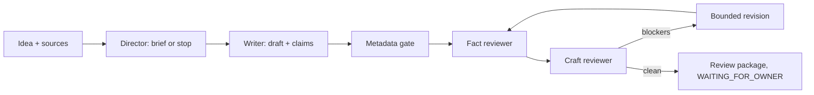

# 1. What an agent is here

In this codebase, one role invocation is one model call with a fixed prompt, skills, task, and output shape; a pipeline is a sequence of those invocations. The runner decides when to make each call and what to do with the result.

The current pipeline is pack-driven. The legacy CLI and the loopback Service use the same `agent-run.ts` engine, but the Service binds approved direction and disclosure state from its signed authority store and runs the tenant-configured provider (fixture by default) in a forked worker.

Three files define the idea:

- [`packs/newsletter/pack.json`](../../packs/newsletter/pack.json) maps each role to a prompt file and the skills it may read; [`packs/conversion-copywriting/pack.json`](../../packs/conversion-copywriting/pack.json) uses the same pipeline for conversion work.
- [`studio-runner/src/model-port.ts`](../../studio-runner/src/model-port.ts:19) defines `ModelPort`, the one interface every provider implements.
- [`studio-runner/src/agent-run.ts`](../../studio-runner/src/agent-run.ts:1) runs the pipeline.

## One role, one job

The newsletter pipeline has four roles:

| Role | Question it answers | What it sees |
| --- | --- | --- |
| `director` | Is this idea worth producing, and for whom? | Idea, audience, source summaries |
| `writer` | Write the draft against the approved brief. | Brief, sources, role skills |
| `fact_reviewer` | Does every claim in the draft appear in a source? | Draft claims, sources |
| `craft_reviewer` | Does the draft work for the reader? | Draft, craft rubric |

The roles are separate on purpose. The writer is asked to produce something specific. The reviewers are asked to find problems. If one model wrote the draft and then graded it in the same call, it would mostly agree with itself. Splitting the call forces the reviewer to start from the text and the evidence, not from the writer's train of thought.

The code enforces the separation. In `agent-run.ts`, the fact reviewer receives the claims manifest and the sources. The craft reviewer receives the draft and its rubric. Neither receives the writer's intermediate reasoning. Reviewers see the work, not how it was made.

Independent review here means a separate invocation with separated inputs. The fact reviewer gets the claims manifest and sources; the craft reviewer gets the draft and rubric. Neither gets the writer's reasoning. All roles may use the same model family, so this is input isolation, not a different auditor or vendor. `agent-run.ts:532` states that limit in the review package.

## The pipeline is explicit

A single prompt like "write and check a newsletter" cannot prove that review happened, that a source was read, or that a revision stayed inside its budget. So the runner writes out the steps:



Each arrow is a recorded event. Each box has a defined input and output. If the director returns `INSUFFICIENT_EVIDENCE`, the run stops before the writer is called. If the metadata gate fails, the draft never reaches a human as if it were finished.

You can read the states in the pipeline code, not in a prompt. `agent-run.ts` records `step_complete` events and sets `WAITING_FOR_OWNER` only after review and packaging succeed.

## Prompts are data, models are replaceable

The role prompt is a file. The skills are files with hashes. Before a run, the runner pins them: if a prompt or skill changed since the request was written, the run refuses to start unless you pass `--allow-dirty-pins`. That pin is what makes a later replay meaningful. You are not comparing two runs of a system that quietly changed underneath you.

The model itself sits behind `ModelPort`. The tests inject `FixtureModel`, which returns canned role responses. A local subscription run uses `claude-code-cli` or `codex-cli` as selected by the request or tenant; the Service defaults to fixtures. Nothing in the pipeline assumes a specific vendor, and `modelFor` refuses unknown providers rather than falling back to one ([`model-port.ts`](../../studio-runner/src/model-port.ts:81)).

## Why this shape

A dropped step is visible. A skipped reviewer cannot be hidden inside one large prompt. A prompt change invalidates pinned runs instead of silently altering them. And the same runner can carry a different specialist by swapping the role files and the pack manifest, which is the subject of chapter 5.

The cost is more model calls. A successful first pass with no JSON corrective retries or revisions makes four model calls; retries and revisions add calls within the budget. Four small, inspectable decisions beat one long, unverifiable one.

## Try it yourself

Copy the synthetic workspace and set its provider to the offline fixture:

```sh
cp -R studio-runner/fixtures/agent-sample /tmp/studio-learn-01
node -e "const f='/tmp/studio-learn-01/request.json';const j=require(f);j.provider='fixture';require('fs').writeFileSync(f,JSON.stringify(j,null,2))"
node --experimental-strip-types --no-warnings studio-runner/test/helpers/fixture-run.ts start /tmp/studio-learn-01 /tmp/studio-learn-01/request.json
```

The output ends with a run id, `WAITING_FOR_OWNER`, version `v001`, and:

```json
"calls_by_role": ["director","writer","fact_reviewer","craft_reviewer"]
```

That list is the pipeline explained in one line. Four calls, in order, each with its own role. Change the order in the code and this output changes with it.

Next: [durable runs](02-durable-runs.md).
